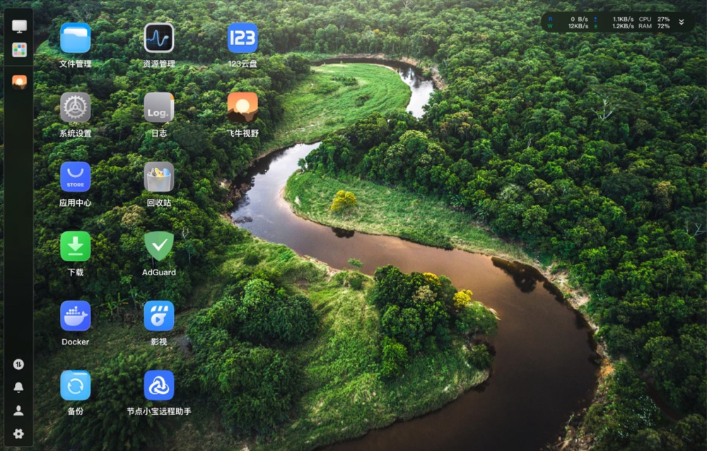
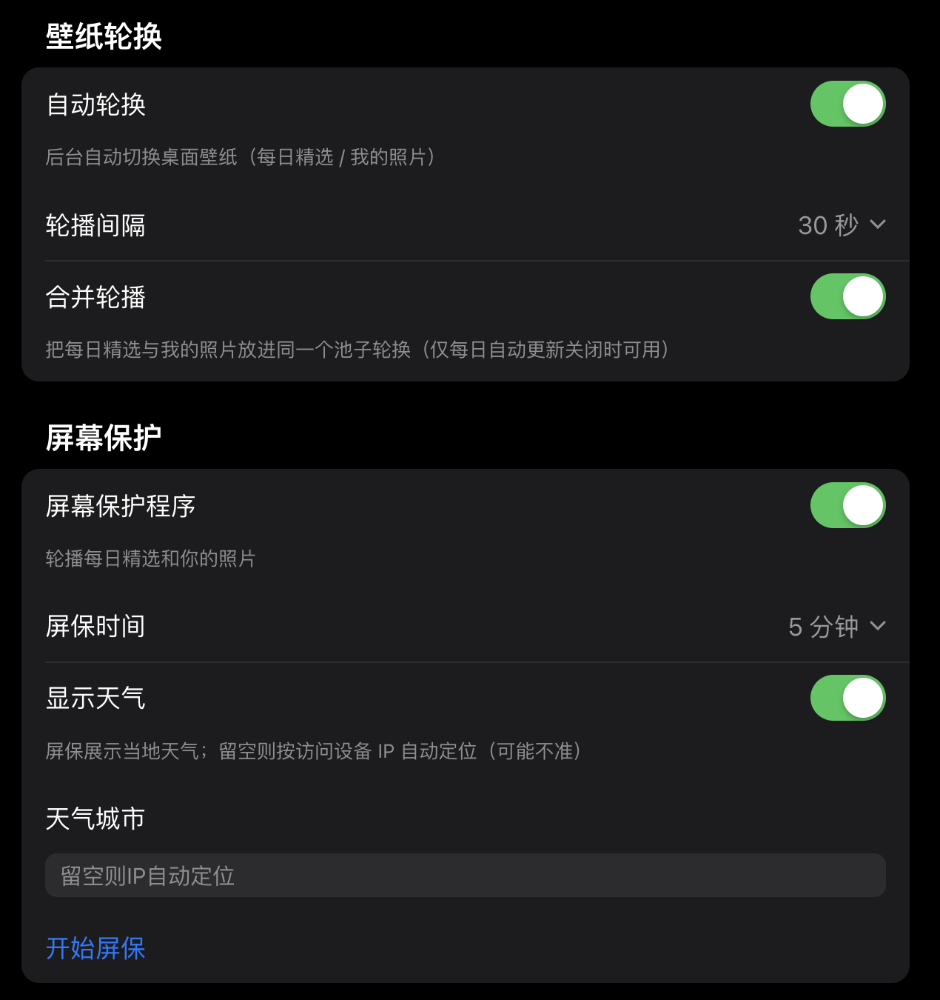

<p align="center">    
  <a href="README_EN.md"><strong>English</strong></a> \\\&nbsp;·\\\&nbsp; <a href="README.md"><strong>中文</strong></a>    
</p>

<h1 align="center">飞牛视野 · FnVista</h1>

<p align="center">    
  让飞牛 fnOS 的登录页与桌面背景每天自动换成 Bing 每日壁纸（4K 原图自动转码 WebP），  

并把你的照片也接入同一套「壁纸」体系——点一下即换、网页不断连，还能开启屏保轮播。

</p>

<p align="center">支持 x86 与 ARM 架构的飞牛 fnOS 设备</p>

<p align="center">    
      
      
      
      
</p>

---

## 功能特性

| 能力         | 说明                                                                              |
| ---------- | ------------------------------------------------------------------------------- |
| **每日自动更新** | 每天定时把 Bing 当日壁纸设为桌面背景；4K 原图自动按最长边等比缩放转码为 WebP，绝不放大变形                            |
| **每日精选**   | 自动保留最近 7 天的真实 Bing 壁纸，点任意一张即可「固定显示」；开启每日更新时若存在真实缺口会自动补齐（维护检修），且严格去重——绝不复制重复图来凑数 |
| **我的照片**   | 把 NAS 目录里的图片、或本机 / 手机上传的图片接入同一套壁纸池，点选即换桌面                                       |
| **屏幕保护**   | 全屏轮播「每日精选 + 我的照片」，叠加时钟（含农历）、天气与城市；语言自适应                                         |
| **壁纸轮换**   | 后台自动切换桌面壁纸，最快 30 秒一轮，轮换带淡入淡出过渡；可合并「每日精选」与「我的照片」同池轮播                             |
| **零断连换壁纸** | 绕过飞牛 nginx 监视，走数据库指针 + 自定义壁纸文件，换壁纸 / 恢复时网页不闪断                                   |
| **多语言**    | 跟随系统语言，无用户选择器；不支持的语言回退英文，中文界面一行不动（zh 安全）                                        |
| **一键还原**   | 原始壁纸自动备份，可随时一键恢复系统默认壁纸                                                          |
| **升级存活自检** | 升级 / 开机 / 看门狗每分钟自愈：定时任务或轮播守护进程掉了自动拉起，杜绝「升级后壁纸不再更新」                              |
| **资源治理**   | 历史图按「最近 N 天 / 最多 M 张」保留并清扫孤儿缩略图；Bing 抓取失败自动重试 4 次并兜底                            |

---

## 截图

> 以下截图以 OEC 设备（已加入个人图片、无隐私顾虑）实机为准。

| 桌面（壁纸实机效果） | 手机端（壁纸选择器） |
| ---------- | ---------- |
|  |  |

| 每日精选 | 屏幕保护 |
| ---------- | ---------- |
|  |  |

| 设置页（中文） | 我的照片 |
| ---------- | ---------- |
|  |  |

---

## 工作原理（简述）

飞牛 fnOS 自研的 nginx 模块会监视登录页背景文件，一旦被覆盖就重启 nginx、造成网页「连接已断开」。  
飞牛视野因此**绝不覆盖**该背景文件、也**绝不 reload nginx**，而是：

- 桌面壁纸实际取自飞牛 `trim_sac` 的自定义壁纸行文件（不受监视）；
- 点选 / 轮播 / 恢复一律走数据库指针回退 + 自定义壁纸文件；
- Bing 当日图经 ffmpeg 按最长边等比缩放转码为 WebP，绝不放大变形。

这样既实现了「每天自动换、点一下就换、轮播也不断连」，又不会触发飞牛的断连保护。  
（早期版本还踩过 `chattr` 锁、ffmpeg 写不进 `/usr/trim/www`、替换间隙被还原等坑，均已规避。）

---

## 安装

### 方式一：应用中心（推荐）

1. 在飞牛 fnOS 应用中心上传 `FnVista-<版本>.fpk`；
2. 按向导完成安装（安装过程会自动部署后台脚本并写入定时任务）；
3. 刷新浏览器即可看到新的桌面壁纸。

### 方式二：一键脚本（命令行）

```bash
curl -fsSL https://raw.githubusercontent.com/mclhm8182/FnVista/main/install.sh | sudo bash
```

脚本会检查环境（ffmpeg 等）、部署后台脚本、写入每日定时任务，并立即应用当日壁纸。

---

## 使用

- **每日自动更新**：开启后每天定时把 Bing 当日壁纸设为桌面；若「每日精选」不足 7 张会自动补齐。
- **固定某张**：在「每日精选」里点任意一张，即可固定显示它（此时每日自动更新暂停）。
- **我的照片**：添加 NAS 目录里的图片，或本机 / 手机上传，点选即换桌面。
- **屏幕保护**：开启后在「开始屏保」里进入全屏轮播，叠加时钟（含农历）、天气与城市。
- **壁纸轮换**：开启后后台自动切换桌面壁纸；可合并「每日精选」与「我的照片」同池轮播（仅每日自动更新关闭时可用）。
- **恢复系统壁纸**：一键还原为飞牛原始壁纸，并关闭每日更换与轮播。

---

## 常见问题

**Q：为什么「每日精选」是 7 张而不是更多 / 更少？**  
默认保留最近 7 天（可在 `/var/lib/fnos-wallpaper/retention_days` 覆盖），恰好 7 张。  
若某天抓取失败或设备离线导致不足 7 张，开启「每日自动更新」或次日运行时会自动补齐**真实存在的 Bing 当日图**。  
补齐严格去重：若 Bing 归档本身在某日复用同一张图、导致最近 7 个自然日不足 7 张不同图，则以真实数量为准，绝不复制重复图来凑数。

**Q：换壁纸会让网页断连吗？**  
不会。飞牛视野采用零断连通道，换壁纸 / 恢复都不会 reload nginx。

**Q：支持英文界面吗？**  
支持。界面跟随系统语言：中文界面完全不变；系统语言非中文时整体回退英文。

**Q：我的照片隐私？**  
照片仅存于本机 NAS 的 `/var/lib/fnos-wallpaper/`，不上传任何外部服务；仅在你授权的设备上用于桌面 / 屏保。

---

## 文件结构

| 路径           | 说明                                            |
| ------------ | --------------------------------------------- |
| `fpk/`       | fpk 应用包源工程（应用中心安装方式）                          |
| `fpk/app/`   | 运行时文件：UI（`ui/index.cgi`）与后台脚本                 |
| `fpk/cmd/`   | 生命周期钩子：安装 / 升级 / 卸载 / 配置 / 启停（部署后台脚本 + 写定时任务） |
| `scripts/`   | 脚本方式安装的同源脚本                                   |
| `install.sh` | 脚本方式一键安装 / 卸载                                 |
| `dist/`      | 预打包好的 fpk 产物                                  |
| `versions/`  | 每个版本的完整源码快照（只增不删）                             |

运行时产生的文件：`/usr/local/sbin/*`（后台脚本）、`/etc/cron.d/fnos-bing-wallpaper`（定时任务）、  
`/var/lib/fnos-wallpaper/`（缓存与备份）、`/var/log/fnos-bing-wallpaper.log`（日志）。

---

## 致谢

思路参考 [playGitboy/fnOS\_wallpaper\_diy](https://github.com/playGitboy/fnOS_wallpaper_diy)  
与 [pengchujin/aerial-tv](https://github.com/pengchujin/aerial-tv)（壁纸轮播逻辑），  
在其基础上改用 ffmpeg 转码、修正了 chattr 的处理方式，并加入 Bing 抓取、幂等控制、本地相册与多语言支持。

Bing 每日壁纸版权归 Microsoft / 原作者所有，本项目仅抓取公开接口用于个人设备的登录页背景。

## 许可证

[MIT](LICENSE)
