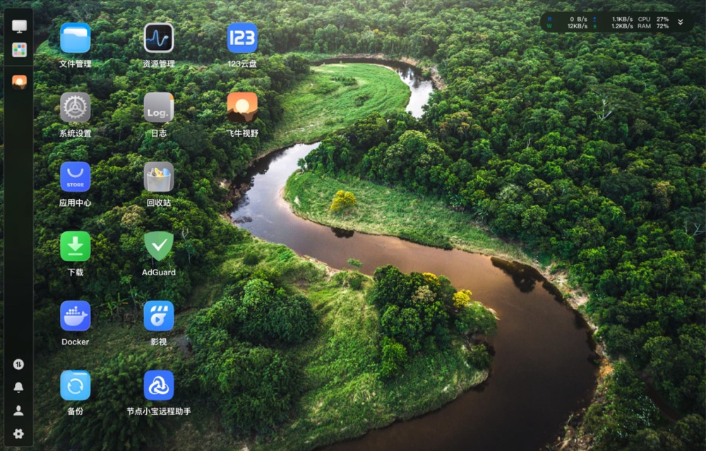
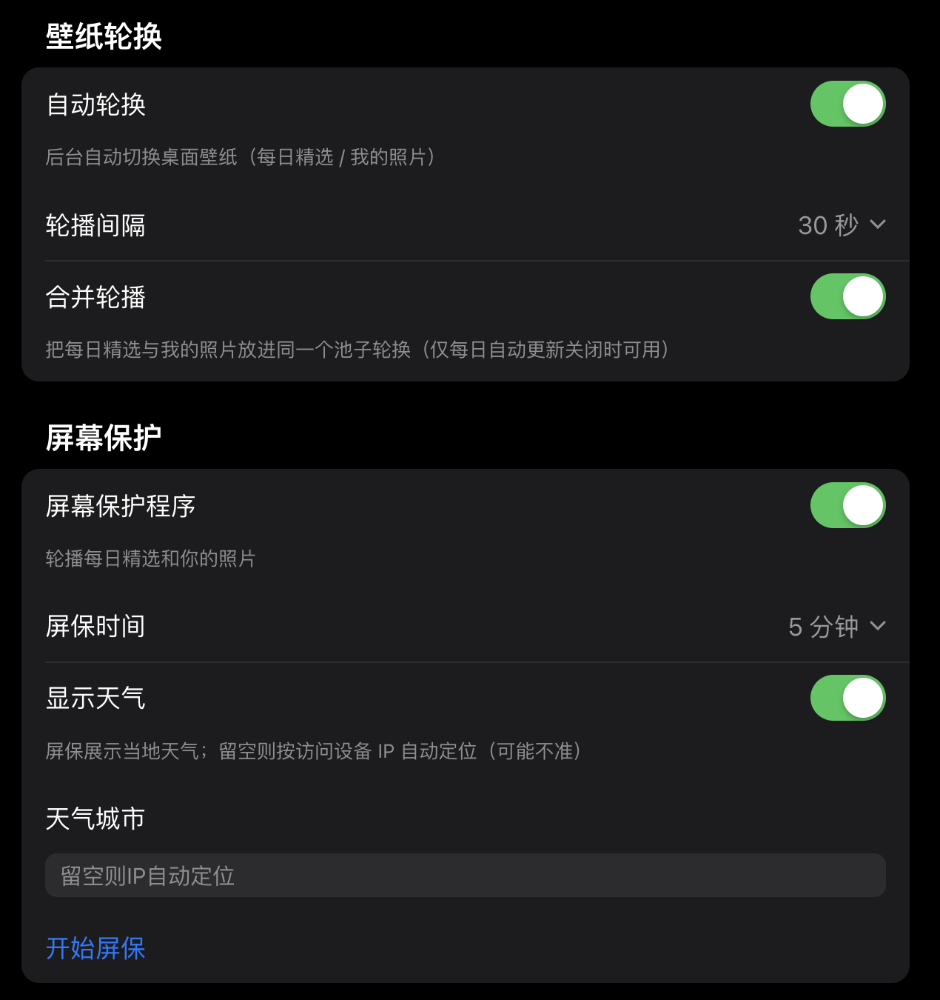

<p align="center">
  <a href="README_EN.md"><strong>English</strong></a> &nbsp;·&nbsp; <a href="README.md"><strong>中文</strong></a>
</p>

<h1 align="center">FnVista · Bing Wallpaper for fnOS</h1>

<p align="center">
  Automatically set your fnOS desktop background to the Bing daily wallpaper every day<br>
  (4K original transcoded to WebP), and bring your own photos into the same wallpaper pool —<br>
  one click to apply, no page disconnect, plus a screensaver slideshow.
</p>

<p align="center">Supports both x86 and ARM fnOS devices</p>

<p align="center">
  
  
  
  
</p>

---

## Features

| Capability | Description |
| --- | --- |
| **Daily auto-update** | Sets the Bing daily wallpaper as your desktop background on a schedule; 4K originals are scaled by longest edge and transcoded to WebP (never upscaled) |
| **Daily Picks** | Keeps the last 7 days of Bing wallpapers; click any one to pin it; auto-backfills to 7 when daily auto-update is enabled (self-healing) |
| **My Photos** | Bring photos from a NAS folder, or upload from your computer / phone, into the same wallpaper pool — one click to apply |
| **Screensaver** | Full-screen slideshow of Daily Picks + My Photos, with a clock (incl. lunar calendar), weather and city; language-adaptive |
| **Wallpaper rotation** | Background auto-switching as fast as every 30s with a fade transition; can merge Daily Picks and My Photos into one pool |
| **Zero-disconnect swap** | Bypasses fnOS's nginx watch by using a DB pointer + custom wallpaper file, so applying / restoring never drops the web page |
| **Multilingual** | Follows the system language with no selector; falls back to English for unsupported languages; the Chinese UI is untouched (zh-safe) |
| **One-click restore** | The original wallpaper is auto-backed-up; restore fnOS's default wallpaper anytime |
| **Upgrade survival check** | Self-heals on upgrade / boot / watchdog every minute: recreates cron jobs or restarts the rotation daemon if they die — no more "wallpaper stopped updating after upgrade" |
| **Resource governance** | Keeps history by "last N days / max M photos" and sweeps orphan thumbnails; retries Bing fetch up to 4× with fallback |

---

## Screenshots

> Captured on the OEC device (personal photos added, no privacy concern). The UI shown is Chinese; when the system language is not Chinese, the same layout falls back to English.

| Desktop (live wallpaper) | Phone (wallpaper picker) |
| --- | --- |
|  |  |

| Daily Picks | Screensaver |
| --- | --- |
|  |  |

| Settings (Chinese) | My Photos |
| --- | --- |
|  |  |

---

## How it works (brief)

fnOS tightly protects the login-page background file: if it is modified externally, nginx restarts and fnOS auto-restores the file — disconnecting the web page (~11s).
FnVista therefore **never modifies** the login background and **never reloads nginx**. Instead, all changes are applied only to the desktop wallpaper:

- The desktop wallpaper actually comes from fnOS `trim_sac`'s custom-wallpaper row file (not watched);
- Selecting / rotating / restoring all go through a DB pointer rollback + custom wallpaper file;
- The Bing daily image is scaled by longest edge via ffmpeg and transcoded to WebP (never upscaled).

This delivers "auto-change daily, change on click, rotate without disconnect" while never tripping fnOS's disconnect protection.
(Earlier versions also hit pitfalls like `chattr` locking, ffmpeg unable to write `/usr/trim/www`, and a restore gap during swap — all now avoided.)

---

## Installation

### Option 1: App Center (recommended)

1. Upload `FnVista-<version>.fpk` in the fnOS App Center;
2. Complete the wizard (it auto-deploys the backend scripts and writes the cron job);
3. Refresh the browser to see the new desktop wallpaper.

### Option 2: One-line script (SSH)

```bash
curl -fsSL https://raw.githubusercontent.com/mclhm8182/FnVista/main/install.sh | sudo bash
```

The script checks the environment (ffmpeg, etc.), deploys the backend scripts, writes the daily cron job, and applies today's wallpaper immediately.

---

## Usage

- **Daily auto-update**: when enabled, sets the Bing daily wallpaper on a schedule; auto-backfills Daily Picks to 7 if short.
- **Pin a photo**: click any image in Daily Picks to pin it (daily auto-update pauses).
- **My Photos**: add NAS folder photos, or upload from computer / phone, then click to apply.
- **Screensaver**: open "Start Screensaver" for a full-screen slideshow with clock (incl. lunar), weather and city.
- **Wallpaper rotation**: background auto-switching; can merge Daily Picks and My Photos into one pool (only when daily auto-update is off).
- **Restore system wallpaper**: one click to revert to fnOS's default wallpaper and disable daily update / rotation.

---

## FAQ

**Q: Why is Daily Picks exactly 7, not more / less?**
It keeps the last 7 days by default (override via `/var/lib/fnos-wallpaper/retention_days`), i.e. exactly 7.
If a day's fetch failed or the device was offline and it drops below 7, enabling daily auto-update (or the next daily run) auto-backfills.

**Q: Does applying a wallpaper disconnect the web page?**
No. FnVista uses the zero-disconnect channel; applying / restoring never reloads nginx.

**Q: Is there an English UI?**
Yes. The UI follows the system language: the Chinese UI is entirely unchanged; when the system language is not Chinese the whole UI falls back to English.

**Q: Privacy of My Photos?**
Photos live only on your NAS at `/var/lib/fnos-wallpaper/`, uploaded to no external service, and are used only on your authorized device for desktop / screensaver.

---

## Project layout

| Path | Description |
| --- | --- |
| `fpk/` | fpk app package source (App Center install) |
| `fpk/app/` | Runtime files: UI (`ui/index.cgi`) and backend scripts |
| `fpk/cmd/` | Lifecycle hooks: install / upgrade / uninstall / config / start-stop (deploy backend scripts + write cron) |
| `scripts/` | Source-equivalent scripts for the script-based install |
| `install.sh` | One-line install / uninstall |
| `dist/` | Prebuilt fpk artifacts |
| `versions/` | Full source snapshot per version (add-only, never deleted) |

Runtime files: `/usr/local/sbin/*` (backend scripts), `/etc/cron.d/fnos-bing-wallpaper` (cron),
`/var/lib/fnos-wallpaper/` (cache & backup), `/var/log/fnos-bing-wallpaper.log` (log).

---

## Credits

Inspired by [playGitboy/fnOS_wallpaper_diy](https://github.com/playGitboy/fnOS_wallpaper_diy)
and [pengchujin/aerial-tv](https://github.com/pengchujin/aerial-tv) (wallpaper rotation logic),
extended with ffmpeg transcoding, corrected `chattr` handling, Bing fetching, idempotency, local albums and multilingual support.

The script naming scheme and the Bing-fetch / ffmpeg-transcode structure are derived from
[pmxwxhn/fnos-bing-wallpaper](https://github.com/pmxwxhn/fnos-bing-wallpaper) (**MIT License, Copyright (c) 2026 pmxwxhn**).
This project rewrites it as a native fnOS FPK app and switches to a "DB pointer + trim_sac custom-wallpaper row file"
zero-disconnect channel — no longer relying on `chattr` to lock `wallpaper-1.webp` (fnOS auto-restores that file within seconds,
so the lock cannot hold) — and adds a web UI, screensaver slideshow, My Photos and multilingual support.
Its copyright notice is preserved here per the MIT License.

Bing daily wallpaper copyright belongs to Microsoft / the original authors; this project only fetches the public API for personal device desktop and screensaver backgrounds.

## License

[MIT](LICENSE)
